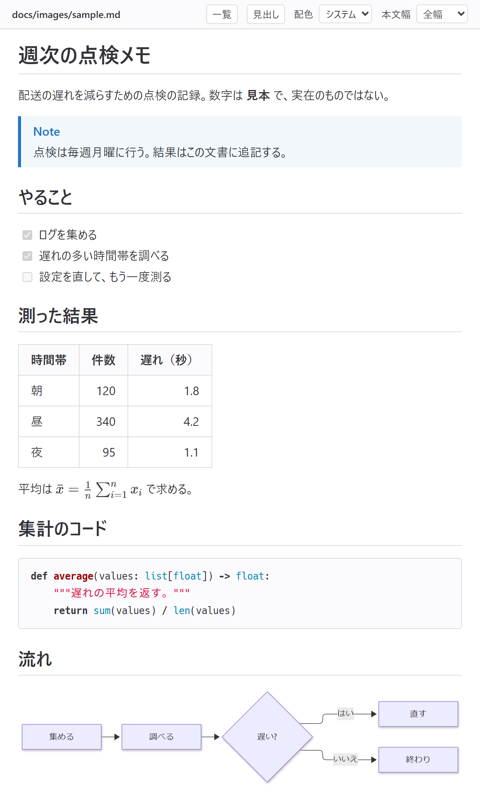
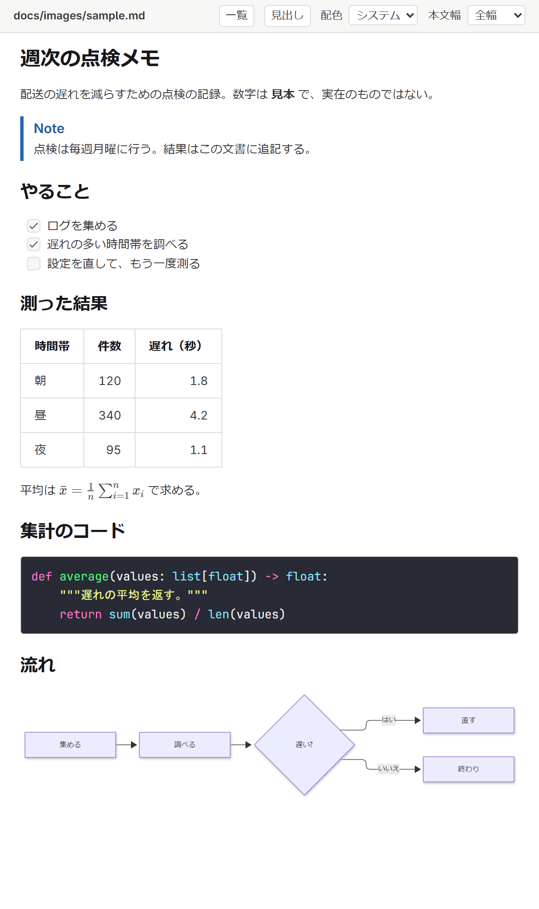
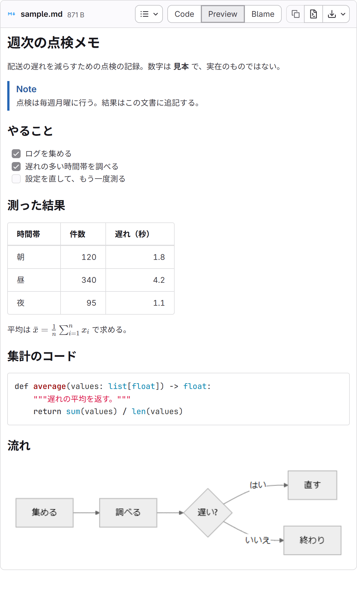
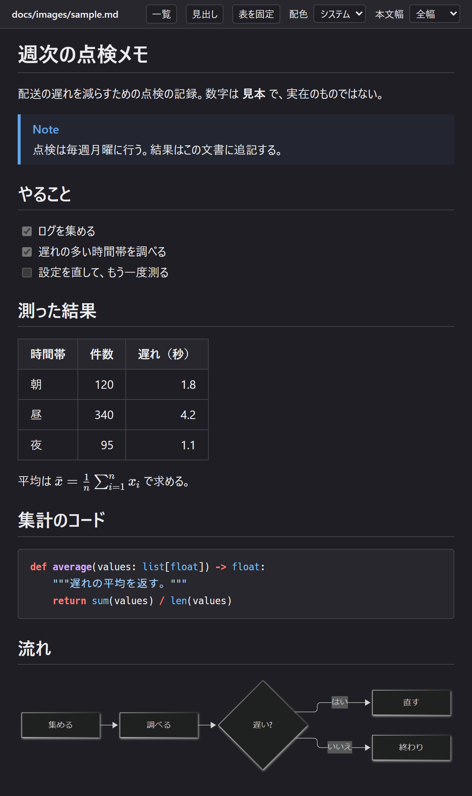
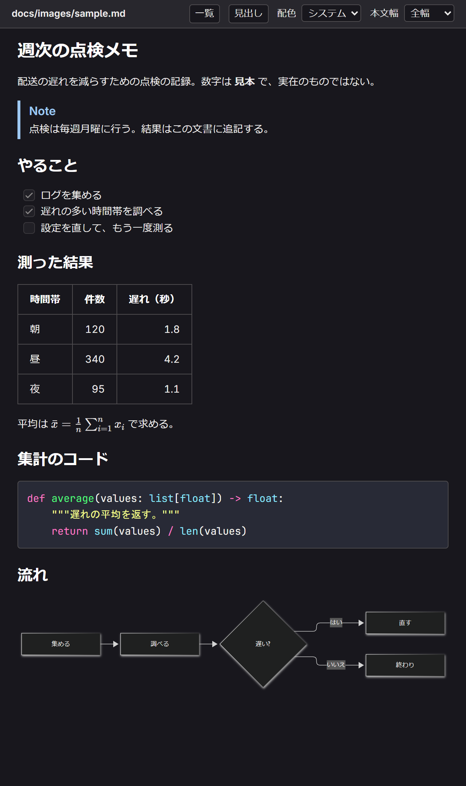
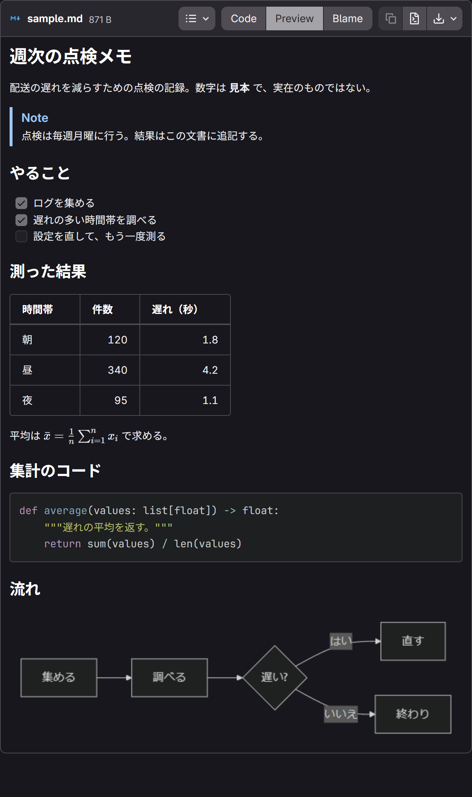

# md-tools

Markdown を扱う 3 つの道具をまとめたリポジトリ。

| 道具 | コマンド | 内容 | 文書 |
| --- | --- | --- | --- |
| md-preview | `mdpreview` | Markdown を GitLab の描画で手元でプレビューし、画面で編集する | この README と [docs/](docs/) |
| md-table-excel | `mdtable` | Markdown の表を Excel で編集して書き戻す | [mdtable/README.md](mdtable/README.md) |
| md-table-sticky | （ブックマークレット） | GitLab の Markdown の表で先頭行・先頭列を固定し、折り返し・幅を切り替える | [sticky/README.md](sticky/README.md) |

この README の残りは、md-preview（`mdpreview`）の説明。

Markdown を GitLab の描画でプレビューするアプリ（`mdpreview`）。本文を GitLab に送らず、手元で HTML にする。

AlmaLinux 10・Windows 11 の導入・更新の手順は [docs/install.md](docs/install.md)、使い方の手順は [docs/usage.md](docs/usage.md) にある。
設計は [docs/reference/readme.md](docs/reference/readme.md) にある。

## 画面

同じ Markdown（[docs/images/sample.md](docs/images/sample.md)）を表示した画面。左と中央は `mdpreview` のプレビューで、左は同梱のスタイル、中央は GitLab の公式スタイル（任意。`mdpreview install-style` で取得すると、次に起こしたプレビューから使う）。右は、比べるために同じファイルを gitlab.com に置いて開いた、GitLab のファイルの画面。上の段はライト、下の段はダークの配色。

| プレビュー<br>（同梱のスタイル） | プレビュー<br>（GitLab の公式スタイル） | GitLab<br>（gitlab.com の画面） |
| --- | --- | --- |
|  |  |  |
|  |  |  |

どれも Windows 11 の Edge で撮った。プレビューの「配色」は既定の「システム」のままで、ライトとダークは、ブラウザの配色の設定を切り替えて撮った。gitlab.com の画面は、ファイルの画面（GitLab 19.6）をログインせずに開き、ファイルの枠（名前の帯と本文）だけを切り取った。公式スタイルのプレビューと gitlab.com の画面で見た目が違うのは、コードの配色（プレビューは、ライト・ダークとも Dracula）、mermaid の図の配色と大きさ、表の枠、チェックボックス。日本語の字形は、OS に入っているフォントで変わる。

## できること

- Markdown を GitLab に送らず、手元で描いてブラウザに表示する。ファイルの保存に合わせて描き直す。Neovim からは未保存の内容も表示する
- 本文の相対リンクから別の Markdown へ移り、ブラウザの戻る・進むで行き来する。「一覧」でルート内の文書を選び、「見出し」で見出しの一覧を左に出し入れする
- 「GitLab との違い」で、参照・図・提案・取り込み・絵文字・メディアの知らせを読み、本文の該当する行へ移る
- 「表を固定」で、表の先頭行・列の固定、折り返し、全幅表示を使う
- `--edit` を付けると、プレビューの画面で表、段落・見出し・リストなどの原文、タスクのチェックボックスを編集し、Markdown のファイルへ書き戻せる。「表を固定」で固定・全幅表示にしたまま表を編集できる。行・列の複製、Shift による範囲の選択、コピー・切り取り・貼り付け、行・列への挿入貼り付けと移動を扱う。Excel 向けには TSV と HTML、mdpreview の別のタブへは原文・属性を保つ写しを渡す
- `::include{file=…}` でルート内のファイルを取り込む。取り込むファイルの変更・削除・作成に合わせて描き直す
- 数式（KaTeX）と図（mermaid）を、同梱のライブラリで描く。PlantUML の図は、`plantuml` コマンドが入っていれば、手元のそのコマンドで描く
- 表の操作には、[sticky/](sticky/) の md-table-sticky（`sticky/src/sticky-table.js` を埋め込む）を使う
- Markdown を HTML に書き出す。スタイルと、文書に必要な数式・図のライブラリを埋め込み、サーバーを起こさずにブラウザで開ける形にする
- ブラウザから印刷する。印刷用の表示では操作欄・見出し欄・知らせを隠す
- 配色（システム・ライト・ダーク）と本文幅（全幅・固定幅）を切り替える。任意で GitLab の公式スタイルとフォントを取得し、プレビューに使う
- Neovim（[LazyVimStarter](https://github.com/ryo-aoki-pc/LazyVimStarter)）からは、カーソルに合わせたスクロールと、プレビューのダブルクリックによるエディタの行への移動も行う。プレビューの画面の「編集」で直した内容は、ファイルではなく Neovim のバッファへ入る（保存は `:w`、取り消しは `u`）

## 導入

Go の単体の実行ファイルを、GitHub Releases から取得して置く。利用する端末に Go・Node.js・git は要らない。取得したファイルは sha256 で確かめる。

| OS | 導入・更新の手順 |
| --- | --- |
| AlmaLinux 10 | [md-preview を導入・更新する](docs/install.md#md-preview-を導入更新する) |
| Windows 11 | [Windows 11 で md-preview を導入・更新する](docs/install.md#windows-11-で-md-preview-を導入更新する) |

公式スタイルは任意。[AlmaLinux 10 の取得手順](docs/install.md#md-preview-の公式スタイルを取得する)・[Windows 11 の取得手順](docs/install.md#windows-11-で-md-preview-の公式スタイルを取得する)に従う。未導入なら同梱のスタイルで表示する。

PlantUML の図も任意。Windows 11 は [Windows 11 で PlantUML を入れる](docs/install.md#windows-11-で-plantuml-を入れる)に従う。AlmaLinux 10 の導入の手順はまだ無い（`plantuml` コマンドが PATH にあれば使う）。`plantuml` コマンドが無ければ、図は原文のコードブロックで表示する。

## 使い方

```sh
mdpreview README.md                  # ファイルを開く
mdpreview docs                       # フォルダーの Markdown の一覧を開く
mdpreview --no-open README.md        # ブラウザを開かず、URL を出す
mdpreview --edit README.md           # 画面で表を編集してファイルへ書く
mdpreview render -o preview.html README.md  # HTML に書き出す
mdpreview --help
mdpreview --licenses                 # 同梱しているもののライセンスの原文を出す
```

- 127.0.0.1 だけで待ち受け、URL に推測できない値を入れる。出てきた URL（`プレビュー: http://127.0.0.1:…`）をブラウザで開く
- 画像・動画・リンクの相対パスは、手元のファイルを指す。読めるのは、開いたファイルのリポジトリ（`.git` のあるフォルダー。無ければファイルのあるフォルダー）の内側だけで、`.git` の中は返さない。`--root <フォルダー>` で変えられる
- `--port <番号>` で待ち受けるポートを、`--browser <実行ファイル>` で開くブラウザを指定する。Ctrl+C で終わる

ファイルを作って確かめる手順、画面の操作、HTML への書き出しは [md-preview の使い方](docs/usage.md) にある。Neovim からは、[LazyVimStarter](https://github.com/ryo-aoki-pc/LazyVimStarter) の `<leader>cp` で使う。

| OS | プレビューで表を編集する手順 |
| --- | --- |
| AlmaLinux 10 | [mdpreview のプレビューで表を編集する](docs/usage.md#mdpreview-のプレビューで表を編集する) |
| Windows 11 | [Windows 11 の mdpreview のプレビューで表を編集する](docs/usage.md#windows-11-の-mdpreview-のプレビューで表を編集する) |

## 外へ通信する場面

- 本文が外部の URL の画像・動画・音声を指すとき、ブラウザがその URL から読む（書き出した HTML を開くときも同じ）
- 利用者が `mdpreview install-style` を実行したとき、公式の CSS・フォント・ライセンスを取得する。`--check` は取得しない
- 開発用の `tools/make-fixtures.mjs` を実行したとき、合成の Markdown だけを gitlab.com に送り、描画の見本を取得する。アプリからは呼ばれない

これ以外は外へ通信しない。プレビューの表示と HTML への書き出しでは、公式スタイルやライブラリを取得しない。PlantUML の図は手元の `plantuml` コマンドで描き、図の中から URL を読む記法は止めている。

## 描画エンジン

GitLab は、Markdown を gem `gitlab-glfm-markdown`（Rust。Comrak に GitLab の整形を重ねたもの）で HTML にしている。このリポジトリは、その gem の `glfm.rs`・`formatter.rs` を書き換えずに WebAssembly にビルドして使う。構文解析と整形の段は、GitLab と同じコードが動く。

- 合わせている版: GitLab 19.5.1（gem 0.0.45、Comrak 0.56.0）。固定値は [engine/engine.lock.json](engine/engine.lock.json)
- gem に渡すオプションは、GitLab の `OPTIONS` と同じ値にしてある。GitLab が機能フラグで決める `github_pre_lang` だけは、`<pre lang="…">` の形に固定している
- `engine/glfm_markdown.wasm` は外の機能を何も取り込まない。実行ファイルに埋め込み、`engine` パッケージが wazero で動かす。利用する端末に Rust や WebAssembly の実行環境を別に入れる必要はない
- gem とその依存のライセンスの原文は [engine/licenses/](engine/licenses/) にある

`engine` パッケージの出力は消毒していない（GitLab も、この後ろの段で消毒する）。

## 消毒とフィルター

GitLab は、エンジンの HTML に Ruby のフィルター（`Banzai::Pipeline::GfmPipeline`）を順に掛けて、最終の HTML にする。`internal/pipeline` の `Renderer.Render` は、その順序で `internal/sanitize`・`internal/filters`・`internal/highlight` を通す。HTML の木は `golang.org/x/net/html` で扱う。

- 消毒は GitLab と同じ許可リスト（html-pipeline の許可リストに GitLab の差分を重ねたもの）で行う。`<script>`、`on…` の属性、`javascript:` のリンクなどは出力に残らない
- 写したフィルター: コードの言語、JSON の表、画像の幅と高さ、数式と mermaid の目印、色のチップ、動画と音声、目次、脚注、差分の記法、画像のリンク、外部リンク、タスク、文字の向き、コードの配色
- `::include{file=…}` は、読み込みの関数を渡したときだけ、ルートの内側のファイルで展開する（32 個まで・再帰しない。GitLab のリポジトリの表示と同じ決まり）。URL は取り込まず、その URL へのリンクにする
- PlantUML は、PATH の絶対パスの項目に `plantuml` があれば手元のコマンドで SVG にする。原文は標準入力に渡し、外部への通信とファイルの取り込みを `SANDBOX` で止める。無い場合と `--no-plantuml` を付けた場合、256 KiB を超える図は原文のコードブロックのまま出す。描画に失敗した場合も原文を表示する
- HTML への書き出しでは、描けた PlantUML の SVG を画像として埋める。PlantUML のためのスクリプトは入れない
- 写していないもの（原文のまま出す）: `#123`・`@名前` などの参照、Kroki、提案（suggestion）、独自の絵文字
- `notices` に、GitLab では別の見え方になる所（参照になりうる記法、原文のまま残った図、取り込めなかった include、文字のまま残った絵文字の短縮記法、手元に無い画像）を、原文の行と一緒に返す
- GitLab と違う所: 絵文字の短縮記法（`:smile:`）は `<gl-emoji>` で包まず文字にする。脚注の ID に乱数を付けない。外部の画像は GitLab の中継を通さず、元の URL から読む。コードの配色は Chroma が作る。クラスは GitLab と同じ短い名前に対応づけ、包みと行の span は GitLab と同じ形にする。字句の区切りと色分けには違いがある

合成の Markdown 17 個を gitlab.com の API に送って保存した HTML（`test/fixtures/`）と、試験で比べている。上の違いと、GitLab のデータや設定が要る 11 か所（`internal/pipeline/testdata/known_differences.json`）を除いて、要素・属性・文字が一致する。

## テスト

Go 1.27.3 を使う。

```sh
go vet ./...
go test ./...
gofmt -l .
```

ブラウザの試験は開発用で、Node.js 22 以上・Go・Playwright と、Edge・Chrome・Chromium のどれかが要る。

```sh
node --test test/page.test.mjs
```

`test/page.test.mjs` は試験用サーバーと書き出しのコマンドを Go でビルドし、本物の KaTeX・mermaid をブラウザで描く。Playwright を通常の場所から読めないときは、`PLAYWRIGHT_MODULE` に導入先を指定する。ブラウザの場所は `EDGE_BIN`・`CHROME_BIN` で指定できる。必要な道具が無ければ理由を付けて skip する（合格には数えない）。

写しの更新処理は `node --test test/page-libs.test.mjs` で確かめる。合成の npm パッケージを使い、外へ通信しない。

GitLab の本物の出力との比較は `go test ./...` に含まれる。保存済みの見本を使い、試験中は GitLab へ通信しない。作り直す手順と決まりは [AGENTS.md](AGENTS.md) にある。

## ライセンス

md-preview・md-table-excel・md-table-sticky は、どれも MIT ライセンス。原文は、それぞれ [LICENSE](LICENSE)・[mdtable/LICENSE](mdtable/LICENSE)・[sticky/LICENSE](sticky/LICENSE) にある。

`mdpreview`・`mdtable` に同梱しているもののライセンスの原文は、それぞれ `mdpreview --licenses`・`mdtable --licenses` で出す。一覧は [licenses/manifest.json](licenses/manifest.json)・[mdtable/licenses/manifest.json](mdtable/licenses/manifest.json) にある。
