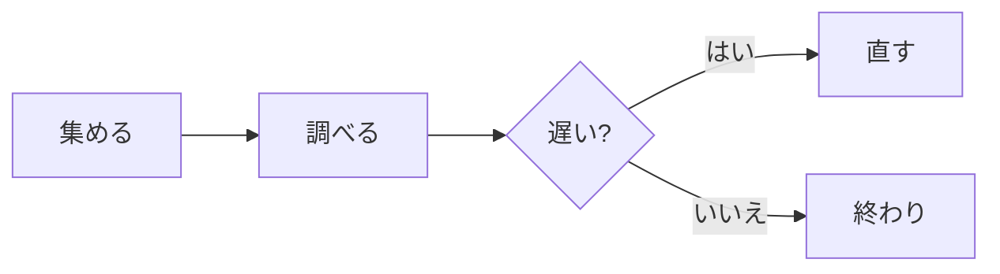

# 週次の点検メモ

配送の遅れを減らすための点検の記録。数字は **見本** で、実在のものではない。

> [!note]
> 点検は毎週月曜に行う。結果はこの文書に追記する。

## やること

- [x] ログを集める
- [x] 遅れの多い時間帯を調べる
- [ ] 設定を直して、もう一度測る

## 測った結果

| 時間帯 | 件数 | 遅れ（秒） |
| :--- | ---: | ---: |
| 朝 | 120 | 1.8 |
| 昼 | 340 | 4.2 |
| 夜 | 95 | 1.1 |

平均は $`\bar{x} = \frac{1}{n}\sum_{i=1}^{n} x_i`$ で求める。

## 集計のコード

```python
def average(values: list[float]) -> float:
    """遅れの平均を返す。"""
    return sum(values) / len(values)
```

## 流れ


